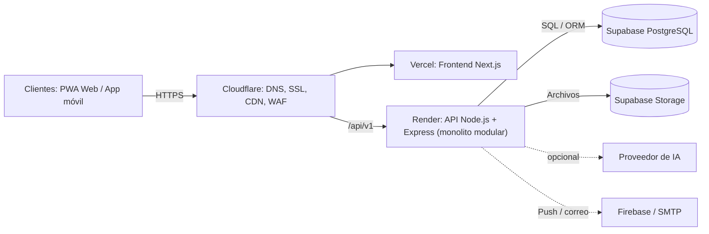

# Arquitectura inicial de UniMarket

UniMarket es un **monolito modular**: una sola aplicación backend desplegable, organizada en ocho módulos de negocio con límites explícitos (ADR-001). Reduce el costo de operación frente a microservicios y deja abierta la extracción futura de un módulo si hay una necesidad demostrable.

## 1. Visión general

Los clientes web y móvil consumen una API REST versionada bajo `/api/v1`. Cloudflare actúa como capa perimetral.

| Elemento | Responsabilidad |
|---|---|
| Frontend web | Next.js (React), PWA adaptable para compradores, proveedores y administradores, alojada en Vercel |
| Aplicación móvil | React Native, cliente de la misma API; si no entra en la primera entrega, queda como evolución prevista |
| API backend | Node.js + Express + TypeScript en Render: monolito modular con reglas de negocio, validación, autorización y orquestación |
| Base de datos | Supabase PostgreSQL: datos relacionales, integridad referencial y transacciones ACID |
| Archivos | Supabase Storage con acceso controlado (bucket privado para vouchers) |
| Borde y entrega | Cloudflare: DNS, HTTPS/TLS, CDN, caché de contenido público y protección perimetral |
| IA externa | Proveedor intercambiable detrás de una interfaz; opcional y con límites de consumo |

## 2. Flujo representativo: pago P2P

El comprador crea una orden (estado `PENDING_PAYMENT`), paga fuera de UniMarket por Yape/Plin/transferencia y sube el voucher a Supabase Storage (`EVIDENCE_SUBMITTED`); el proveedor confirma o rechaza. El backend es *stateless*: el estado vive en la base de datos, no en la memoria del servidor.

## 3. Límites y escalamiento

- 15,000 estudiantes describe la comunidad potencial, no 15,000 solicitudes simultáneas garantizadas.
- La capacidad real se comprueba con pruebas de carga progresivas: 500 usuarios concurrentes como escenario inicial y escenarios mayores como prueba de estrés.
- El backend es *stateless* siempre que sea posible: sesiones y datos persistentes no dependen de la memoria de una instancia.
- Pueden ejecutarse varias instancias detrás del balanceador del proveedor si el plan y el presupuesto lo permiten; es una capacidad futura, no una garantía del plan gratuito.
- No se cachean respuestas privadas, comprobantes, perfiles ni respuestas personalizadas. Órdenes y reservas consultan siempre la base de datos.

## 4. Decisiones que la sustentan

| ADR | Decisión | Driver |
|---|---|---|
| ADR-001 | Monolito modular de ocho módulos | DA01, DA04, DA05 |
| ADR-003 | Caché en dos niveles (Cloudflare + aplicación) | DA06, DA09 |
| ADR-007 | Cloudflare + Vercel + Render + Supabase, un proveedor por capa | DA01, DA06 |
| ADR-009 | API REST única y versionada en `/api/v1` | DA10 |