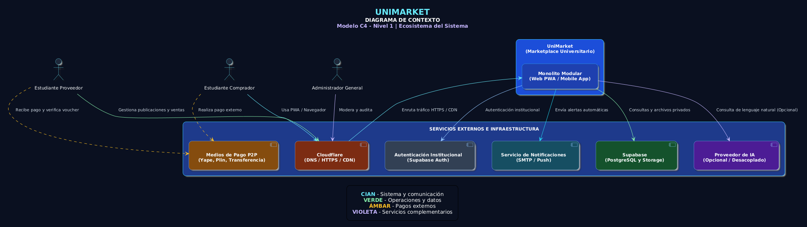

# Nivel 1: Diagrama de Contexto del Sistema (System Context)

El diagrama de contexto muestra a los usuarios principales interactuando con el sistema central **UniMarket** y cómo este último se comunica con los servicios externos de la infraestructura y pasarelas institucionales.

## 1. Actores (Personas / Usuarios)
* **Estudiante Comprador:** Explora UniMarket, adquiere libros o productos usados, contrata tutorías y servicios profesionales, y reserva salas de estudio dentro de la comunidad universitaria.
* **Estudiante Proveedor:** Publica bienes físicos (libros, materiales) y ofrece servicios (tutorías, programación, diseño, impresión), gestionando su portafolio, precios, disponibilidad y confirmación de pagos P2P.
* **Administrador General:** Supervisa la plataforma, modera publicaciones, gestiona cuentas y disputas, revisa registros de auditoría y visualiza reportes estadísticos.

## 2. Sistema Principal
* **UniMarket (Marketplace Universitario):** Plataforma centralizada web y móvil basada en un monolito modular, diseñada para gestionar de forma segura e integrada el catálogo, las transacciones directas P2P, las reservas de horarios y la reputación de los 15,000 estudiantes de la UNSCH.

## 3. Sistemas y Componentes Externos
* **Sistema de Autenticación Institucional (Supabase Auth / SSO):** Valida de forma obligatoria que el usuario pertenezca a la comunidad universitaria mediante el correo institucional verificado (`@unsch.edu.pe`).
* **Medios de Pago P2P Externos (Yape, Plin o Transferencia):** Servicios financieros mediante los cuales los estudiantes realizan transferencias directas de manera externa, sin que la plataforma procese, capture o retenga fondos.
* **Servicio de Notificaciones (Correo / SMTP / Push):** Infraestructura externa encargada de despachar alertas automáticas transaccionales ante cambios de estado en órdenes o reservas.
* **Cloudflare (Borde y Perímetro):** Gestiona la resolución del dominio `.PE`, las conexiones HTTPS con SSL/TLS, la CDN, el caché de contenido público y la protección perimetral contra ataques.
* **Supabase (PostgreSQL y Storage):** Base de datos relacional para la persistencia transaccional ACID y almacenamiento privado seguro para imágenes de productos y comprobantes (*vouchers*).
* **Proveedor de IA Opcional:** Servicio externo basado en herramientas gratuitas o de código abierto para interpretar consultas en lenguaje natural y sugerir productos o servicios (operando de forma desacoplada tras un adaptador).

## 4. Representación Gráfica (Diagrama de Contexto C4)

A continuación se muestra el diagrama arquitectónico de contexto correspondiente al Nivel 1 del sistema:

