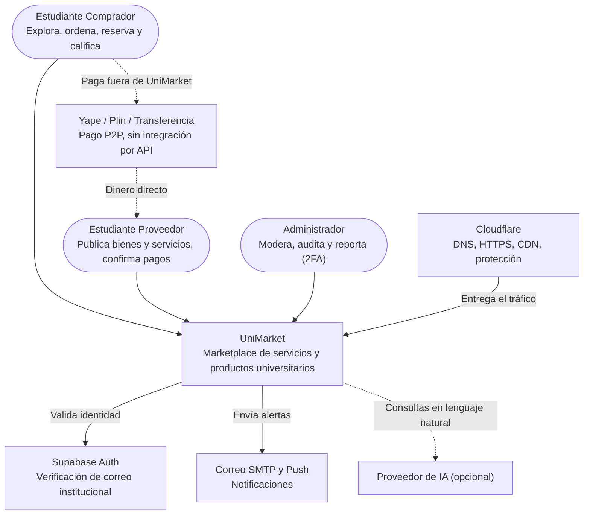

# C4 - Nivel 1: Diagrama de contexto del sistema

Muestra UniMarket en su entorno: quiénes lo usan y con qué sistemas externos se relaciona.

## Actores

| Actor | Descripción |
|---|---|
| Estudiante Comprador | Rol por defecto de todo usuario verificado. Busca, ordena, reserva, sube vouchers y califica |
| Estudiante Proveedor | Comprador con perfil de proveedor activo (medio de pago P2P y contacto). Publica, gestiona disponibilidad y confirma pagos |
| Administrador | Rol operativo con RBAC y 2FA. Modera, suspende, atiende incidencias, audita y exporta reportes |

## Sistemas externos

| Sistema | Función | Integración |
|---|---|---|
| Supabase Auth | Validar identidad universitaria | Solo correos `@unsch.edu.pe` (por confirmar), verificados por enlace o código. SSO/OAuth solo si la universidad lo autoriza |
| Yape, Plin, transferencia | Transferir dinero entre estudiantes | Sin API ni custodia: el comprador paga fuera y sube el voucher |
| Correo SMTP y push | Alertas de órdenes y reservas | Despacho de correos transaccionales y push |
| Cloudflare | DNS, HTTPS/TLS, CDN, caché pública | Protege y entrega el tráfico; no sustituye la autenticación del backend |
| Proveedor de IA | Procesar lenguaje natural | Opcional, tras un adaptador; el sistema funciona sin él |

**Trazabilidad:** RF-01, RF-02 (accesos), RF-06, RF-07 (pagos P2P), RF-09 (notificaciones), RF-13 (IA) · RC02, RC03, RC08, RC09.