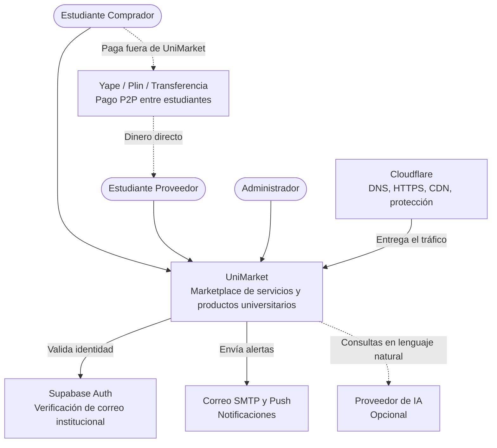

# Nivel 1 · Diagrama de contexto del sistema

> **Proyecto:** UniMarket  
> **Modelo:** C4 · Nivel 1 de 4 · **Versión:** 1.0

---

## 1. Objetivo

Mostrar **UniMarket como una sola caja**: quiénes lo usan y con qué sistemas externos se comunica. Es la vista de mayor nivel y la primera que se presenta a cualquier persona, técnica o no.

| Aspecto | Descripción |
|---|---|
| Pregunta que responde | ¿Qué es el sistema, quién lo usa y con quién se integra? |
| Audiencia | Todos: negocio, docentes, equipo de desarrollo, operaciones |
| Qué **no** muestra | Tecnologías internas, servidores, bases de datos ni módulos |
| Siguiente nivel | `Nivel2-DiagramadeContenedores.md` |

---

## 2. Diagrama

---

## 3. Personas (usuarios)

| Persona | Descripción | Qué hace en el sistema |
|---|---|---|
| **Estudiante Comprador** | Rol de todo estudiante con correo institucional verificado | Busca y filtra el catálogo, crea órdenes, reserva tutorías y salas, sube el voucher de pago, confirma la recepción y califica al proveedor |
| **Estudiante Proveedor** | Estudiante que activó su perfil de proveedor (medio de pago P2P y contacto) | Publica bienes y servicios, define su disponibilidad, revisa vouchers y confirma o rechaza pagos |
| **Administrador** | Responsable de la operación, con permisos elevados y 2FA | Modera publicaciones, suspende cuentas, atiende incidencias, audita y exporta reportes |

---

## 4. Sistemas

| Sistema | Tipo | Responsabilidad | Quién lo construye |
|---|---|---|---|
| **UniMarket** | Sistema en alcance | Permite publicar, buscar, ordenar y reservar productos y servicios dentro de la comunidad universitaria | El equipo del proyecto |
| **Supabase Auth** | Sistema externo | Verifica el correo institucional (por enlace o código) y emite el token JWT | Supabase |
| **Yape, Plin y transferencia** | Sistema externo (sin integración) | Mueven el dinero directamente entre estudiantes; UniMarket no procesa ni retiene fondos | Entidades financieras |
| **Correo SMTP y push** | Sistema externo | Envía correos y notificaciones push sobre órdenes y reservas | Proveedor de correo y Firebase |
| **Cloudflare** | Infraestructura externa | DNS del dominio .PE, HTTPS, CDN, caché de contenido público y protección perimetral | Cloudflare |
| **Proveedor de IA** | Sistema externo opcional | Interpreta consultas en lenguaje natural; el sistema funciona completo sin él | Proveedor de IA |

---

## 5. Relaciones

| Origen | Destino | Descripción | Protocolo |
|---|---|---|---|
| Estudiante Comprador | UniMarket | Busca, ordena, reserva, sube vouchers y califica | — |
| Estudiante Proveedor | UniMarket | Publica ofertas, gestiona disponibilidad y confirma pagos | — |
| Administrador | UniMarket | Modera, audita y consulta reportes | — |
| UniMarket | Supabase Auth | Verifica identidad y emite JWT | HTTPS/REST |
| UniMarket | Correo SMTP y push | Envía notificaciones | SMTP / HTTPS |
| UniMarket | Proveedor de IA | Envía consultas en lenguaje natural (opcional) | HTTPS/REST |
| Estudiante Comprador | Yape, Plin, transferencia | Paga fuera de UniMarket | — |

> En el nivel 1 no se indica el protocolo entre personas y sistema: eso se detalla en el nivel 2.

---

## 6. Decisiones y supuestos

| # | Decisión o supuesto | Motivo |
|---|---|---|
| 1 | Los pagos son P2P, sin API de Yape/Plin ni pasarela | UniMarket no procesa, captura ni retiene fondos (RC03, ADR-004) |
| 2 | Solo acceden correos del dominio institucional verificados | Acceso exclusivo de la comunidad universitaria (RC02, ADR-005) |
| 3 | La IA es opcional y va detrás de un adaptador | El sistema debe funcionar íntegro sin ella (RC09, ADR-008) |
| 4 | Los sistemas externos no se modifican | Son de terceros; UniMarket se adapta a ellos (patrón Adapter) |

### Pendientes por definir

| Tema | Detalle |
|---|---|
| Dominio institucional | El dominio `@unsch.edu.pe` debe confirmarse con la universidad antes de implementarlo |
| SSO/OAuth | Solo se agregará como método adicional si la universidad lo habilita y documenta |

---