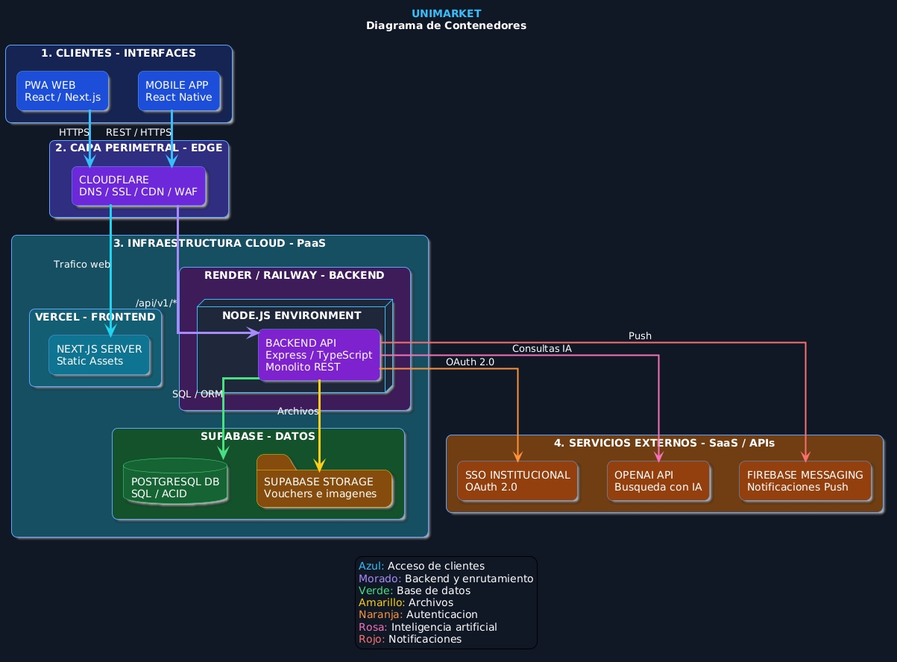

# Nivel 2 · Diagrama de contenedores

> **Proyecto:** UniMarket  
> **Modelo:** C4 · Nivel 2 de 4 · **Versión:** 1.0

---

## 1. Objetivo

Abrir la caja «UniMarket» del nivel 1 y mostrar los **contenedores** que la forman: las aplicaciones y almacenes de datos que se ejecutan por separado, la tecnología de cada uno y cómo se comunican.

| Aspecto | Descripción |
|---|---|
| Pregunta que responde | ¿De qué piezas ejecutables se compone el sistema y con qué tecnología? |
| Audiencia | Arquitectos, desarrolladores, operaciones |
| Qué es un contenedor | Algo que se ejecuta o almacena datos de forma independiente: una aplicación web, una API, una base de datos (no es lo mismo que un contenedor Docker) |
| Nivel anterior | `Nivel1-DiagramadeContextodelSistema.md` |
| Siguiente nivel | `Nivel3-Diagrama-de-Componentes.md` |

---

## 2. Diagrama

## 3. Contenedores

| Contenedor | Tecnología | Responsabilidad | Datos que maneja |
|---|---|---|---|
| **PWA Web** | Next.js (React) · Vercel | Interfaz adaptable para compradores, proveedores y administrador. Se ejecuta en el navegador | Ninguno persistente; solo el estado de la pantalla |
| **App móvil** | React Native | Cliente de la misma API; queda como evolución prevista si el plazo es corto | Ninguno persistente |
| **API UniMarket** | Node.js + Express + TypeScript · Render | Expone la API REST `/api/v1`, aplica las reglas de negocio e integra los servicios externos. Es un **monolito modular**: un solo proceso con ocho módulos internos | Ninguno propio; usa la base de datos y el almacenamiento |
| **Base de datos** | PostgreSQL · Supabase | Guarda de forma permanente la información transaccional con integridad ACID | Usuarios, publicaciones, órdenes, reservas, reseñas y auditoría |
| **Almacenamiento** | Supabase Storage (bucket privado) | Guarda imágenes de publicaciones y comprobantes de pago | Imágenes y vouchers |

---

## 4. Relaciones

| Origen | Destino | Descripción | Protocolo |
|---|---|---|---|
| Comprador, Proveedor, Administrador | PWA Web | Usan la aplicación desde el navegador, a través de Cloudflare | HTTPS |
| PWA Web / App móvil | API UniMarket | Llaman a la API versionada | HTTPS/JSON |
| API UniMarket | Base de datos | Lee y escribe información | SQL sobre TCP |
| API UniMarket | Almacenamiento | Guarda y entrega archivos con URL firmada de corta duración | HTTPS |
| API UniMarket | Supabase Auth | Verifica el JWT del usuario | HTTPS/REST |
| API UniMarket | Correo SMTP y push | Envía notificaciones | SMTP / HTTPS |
| API UniMarket | Proveedor de IA | Consultas en lenguaje natural (opcional) | HTTPS/REST |

---

## 5. Decisiones arquitectónicas reflejadas

| Decisión | Alternativa descartada | Motivo |
|---|---|---|
| Un único contenedor de backend (monolito modular) · ADR-001 | Microservicios | Equipo de dos personas y presupuesto de S/ 100 mensuales; los módulos permiten extraer servicios en el futuro |
| Frontend separado del backend (PWA + API REST) · ADR-009 | Páginas generadas solo en el servidor | Web y móvil consumen la misma lógica de negocio |
| PostgreSQL como base de datos · ADR-006 | Base de datos NoSQL | Órdenes y reservas necesitan transacciones y consistencia (ACID) |
| Supabase Storage privado · ADR-010 | Cloudinary como dependencia simultánea | Mantiene privados los vouchers (Ley N.° 29733); Cloudinary queda solo como alternativa |
| Cloudflare + Vercel + Render + Supabase, un proveedor por capa · ADR-007 | Varios proveedores por capa | Ajuste al presupuesto y seguridad perimetral centralizada |
| Express como único framework · RC05 | Fastify | Mantiene un solo framework en todo el backend |
| Solo la API se comunica con los servicios externos | Llamarlos desde el navegador | Las credenciales quedan en el servidor y no se exponen al cliente |

---

## 6. Seguridad entre contenedores

| Comunicación | Medida |
|---|---|
| Navegador → Cloudflare → PWA y API | Tráfico cifrado con HTTPS/TLS; protección DDoS y reglas WAF básicas |
| PWA → API | Autenticación con token JWT (Bearer) en cada petición privada |
| API → Base de datos | Consultas parametrizadas; credenciales en variables de entorno |
| API → Almacenamiento | Bucket privado; URL firmada de corta duración y verificación de propiedad en cada descarga |
| Caché de Cloudflare | Solo contenido público; las rutas privadas de la API se excluyen |

---