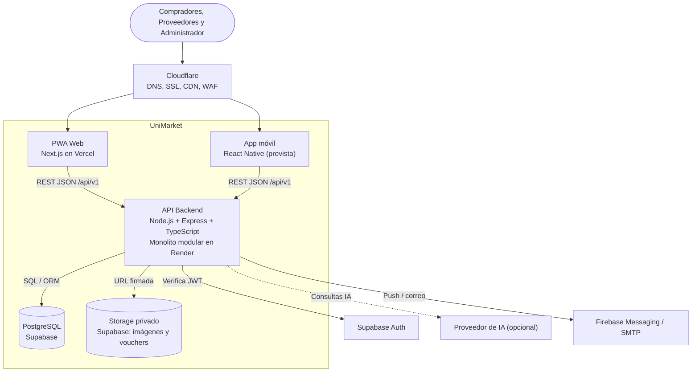

# C4 - Nivel 2: Diagrama de contenedores

Muestra las aplicaciones y almacenes de datos que componen UniMarket y cómo se comunican.

| Contenedor | Tecnología | Responsabilidad |
|---|---|---|
| PWA Web | Next.js (React), Vercel | Interfaz adaptable para los tres roles |
| App móvil | React Native | Cliente de la misma API; evolución prevista si el plazo es corto |
| API Backend | Node.js, Express, TypeScript, Render | Reglas de negocio, validación, autorización, orquestación; 8 módulos |
| Base de datos | PostgreSQL (Supabase) | Datos transaccionales ACID: usuarios, catálogo, órdenes, reservas, auditoría |
| Almacenamiento | Supabase Storage | Imágenes y vouchers; bucket privado con URL firmada de corta duración |
| Borde | Cloudflare | DNS, HTTPS/TLS, CDN, caché de contenido público (nunca rutas privadas) |

**Trazabilidad:** ADR-001, ADR-003, ADR-007, ADR-009, ADR-010 · RC04–RC10, RC13 · AC-02, AC-04, AC-05.