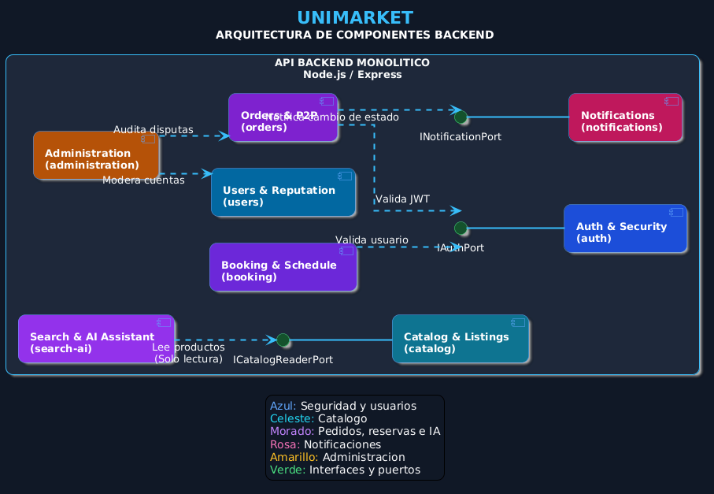

# Nivel 3 · Diagrama de componentes

> **Proyecto:** UniMarket · **Contenedor detallado:** API UniMarket  
> **Modelo:** C4 · Nivel 3 de 4 · **Versión:** 1.0

---

## 1. Objetivo

Abrir el contenedor **API UniMarket** del nivel 2 y mostrar sus **componentes**: los módulos del monolito modular, la responsabilidad de cada uno y cómo se relacionan entre sí y con la base de datos, el almacenamiento y los servicios externos.

| Aspecto | Descripción |
|---|---|
| Pregunta que responde | ¿Cómo se divide el backend por dentro y qué hace cada parte? |
| Audiencia | Arquitectos y desarrolladores |
| Qué es un componente | Un grupo de funcionalidades con una responsabilidad clara, accesible mediante una interfaz. En este proyecto, cada **módulo** del monolito es un componente |
| Nivel anterior | `Nivel2-DiagramadeContenedores.md` |
| Siguiente nivel | `Nivel4-DiagramadeCodigo.md` |

---

## 2. Diagrama

## 3. Componentes

| Componente | Responsabilidad | Funcionalidades principales | Carpeta en el código |
|---|---|---|---|
| **API REST** | Punto de entrada HTTP del contenedor | Rutas `/api/v1`, autenticación JWT, validación de la entrada, manejo de errores | `src/api/` |
| **Auth & Security** | Identidad y acceso | Validación del correo institucional y del token, roles (comprador, proveedor, administrador), 2FA del administrador | `src/modules/auth/` |
| **Users & Reputation** | Perfiles y reputación | Perfil universitario, perfil de proveedor, reseñas verificadas, promedio del proveedor | `src/modules/users/` |
| **Catalog & Listings** | Oferta disponible | Publicación de bienes y servicios, categorías, imágenes, tarifas y portafolio | `src/modules/catalog/` |
| **Orders & P2P** | Proceso de compra | Órdenes, estados, datos de pago y QR del proveedor, voucher, constancia virtual, disputas | `src/modules/orders/` |
| **Booking & Schedule** | Reservas | Disponibilidad de tutorías y salas, reservas sin traslapes | `src/modules/booking/` |
| **Search & AI** | Búsqueda | Búsqueda y filtros, recomendaciones, asistente de lenguaje natural opcional | `src/modules/search-ai/` |
| **Notifications** | Comunicación con el usuario | Avisos de cambios de estado y confirmaciones por correo o push | `src/modules/notifications/` |
| **Administration** | Supervisión | Moderación, suspensión de cuentas, métricas, auditoría, reportes en Excel | `src/modules/administration/` |

---

## 4. Relaciones entre componentes

| Origen | Destino | Descripción | Tipo de comunicación |
|---|---|---|---|
| PWA Web / App móvil | API REST | Llama a la API | HTTPS/JSON |
| API REST | Módulos de negocio | Invoca los casos de uso | Llamada en memoria |
| Todos los módulos | Auth & Security | Autenticación y permisos por rol | `authMiddleware` / `TokenVerifierPort` |
| Orders | Catalog | Verifica publicación activa y precio al crear la orden | Llamada en memoria (`ListingReader`) |
| Orders | Notifications | Publica el cambio de estado | Evento en memoria (`OrderStatusChanged`) |
| Orders | Administration | Registra la resolución de disputas | Llamada en memoria (`AuditLogPort`) |
| Users | Orders | Valida que la orden esté Completada antes de reseñar | Llamada en memoria (interfaz pública) |
| Booking | Catalog | Asocia la tutoría a la publicación del servicio | Llamada en memoria (interfaz pública) |
| Booking | Notifications | Confirma la reserva | Evento en memoria (`ReservationConfirmed`) |
| Search & AI | Catalog | Lee publicaciones para buscar y recomendar | Llamada en memoria (`SearchReader`, solo lectura) |
| Administration | Users | Suspende cuentas | Llamada en memoria (interfaz pública) |

---

## 5. Relaciones con contenedores y sistemas externos

| Componente | Destino | Descripción | Protocolo | Patrón aplicado |
|---|---|---|---|---|
| Todos los módulos | Base de datos (PostgreSQL) | Cada módulo accede a sus datos solo con sus propios repositorios | SQL | Repository |
| Orders y Catalog | Almacenamiento (Supabase Storage) | Guardan vouchers (privados) e imágenes | HTTPS | Adapter |
| Auth | Supabase Auth | Verifica el JWT | HTTPS/REST | Adapter |
| Notifications | SMTP y Firebase | Envía correo y push | SMTP / HTTPS | Adapter |
| Search & AI | Proveedor de IA | Interpreta consultas (opcional) | HTTPS/REST | Adapter + Facade |
| Orders | Medios de pago P2P | Muestra las instrucciones de pago de cada medio (no se integra por API) | — | Strategy |

---

## 6. Reglas del monolito modular

| # | Regla | Motivo |
|---|---|---|
| 1 | Todos los componentes se despliegan juntos en el contenedor API UniMarket | Es un monolito: un solo proceso y un solo despliegue |
| 2 | Un módulo usa a otro solo mediante servicios de aplicación, interfaces públicas o eventos | Evita que un cambio interno en un módulo rompa a los demás |
| 3 | Ningún módulo importa repositorios ni entidades internas de otro | Mantiene la independencia de los datos de cada módulo (puede verificarse en CI con `dependency-cruiser`) |
| 4 | Cada servicio externo se integra en un único módulo | La integración queda en un solo lugar y es fácil de reemplazar |
| 5 | Cada módulo se organiza por dentro con Clean Architecture de cuatro capas | Las reglas de negocio no dependen de la tecnología (ver nivel 4) |

---

## 7. Trazabilidad: de qué requisito sale cada componente

| Componente | Requisitos | Historias | ADR | Atributos de calidad |
|---|---|---|---|---|
| Auth | RF-01, RF-02 | HU-01 | ADR-005 | AC-05 |
| Users | RF-12 | HU-01, HU-09 | ADR-005 | AC-07 |
| Catalog | RF-03, RF-04, RF-05 | HU-02, HU-03, HU-04 | ADR-002, ADR-003 | AC-01, AC-04 |
| Orders | RF-06, RF-07, RF-14 | HU-05, HU-06, HU-11 | ADR-004, ADR-010 | AC-05, AC-07 |
| Booking | RF-08 | HU-03, HU-07 | ADR-006 | AC-02 |
| Search & AI | RF-05, RF-13 | HU-04, HU-10 | ADR-003, ADR-008 | AC-04, AC-06 |
| Notifications | RF-09 | HU-06, HU-07 | ADR-004 | AC-01 |
| Administration | RF-10, RF-11, RF-14 | HU-08, HU-11 | ADR-010 | AC-05, AC-07 |

---