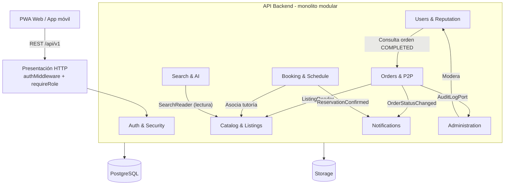

# C4 - Nivel 3: Diagrama de componentes (API Backend)

Muestra los ocho módulos del contenedor *API Backend* y cómo se relacionan mediante puertos e interfaces públicas.

## Trazabilidad: de qué requisito sale cada componente

| Componente | Requisitos | Historias | ADR | Atributos |
|---|---|---|---|---|
| auth | RF-01, RF-02 | HU-01 | ADR-005 | AC-05 |
| users | RF-12 | HU-01, HU-09 | ADR-005 | AC-07 |
| catalog | RF-03, RF-04, RF-05 | HU-02, HU-03, HU-04 | ADR-002, ADR-003 | AC-01, AC-04 |
| orders | RF-06, RF-07, RF-14 | HU-05, HU-06, HU-11 | ADR-004, ADR-010 | AC-05, AC-07 |
| booking | RF-08 | HU-03, HU-07 | ADR-006 | AC-02 |
| search-ai | RF-05, RF-13 | HU-04, HU-10 | ADR-003, ADR-008 | AC-04, AC-06 |
| notifications | RF-09 | HU-06, HU-07 | ADR-004 | AC-01 |
| administration | RF-10, RF-11, RF-14 | HU-08, HU-11 | ADR-010 | AC-05, AC-07 |

Regla: ningún módulo importa repositorios ni entidades internas de otro; solo puertos, servicios de aplicación o eventos.