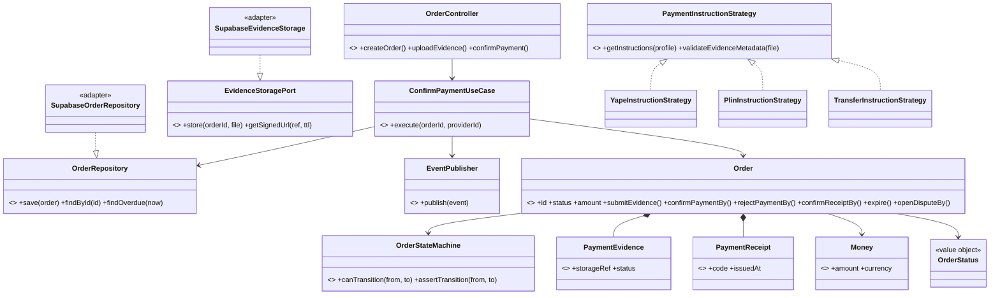

# C4 - Nivel 4: Código (clases)

Baja un componente del nivel 3 hasta sus clases e interfaces. Se detalla a fondo **Orders** (el módulo más complejo: máquina de estados, pagos P2P, vouchers); los demás se resumen con sus clases clave. Se aplica Clean Architecture de cuatro capas con puertos y adaptadores (ADR-002, ADR-004, ADR-008).

## Módulo Orders

```
src/modules/orders/
  domain/          entities/ (Order, PaymentEvidence, PaymentReceipt, Dispute)
                   value-objects/ (Money, OrderStatus, OrderId, PaymentMethod)
                   services/ (OrderStateMachine)  errors/  ports/ (ListingReader)
  application/     use-cases/ dto/ ports/ (OrderRepository, EvidenceStoragePort, EventPublisher, Clock)
  infrastructure/  persistence/ (SupabaseOrderRepository)
                   integrations/ (SupabaseEvidenceStorage, InternalEventPublisher)
                   payments/ (Yape|Plin|Transfer InstructionStrategy)
  presentation/http/  controllers/ routes/ validators/
```




### Casos de uso

| Caso de uso | Requisito · HU | Endpoint |
|---|---|---|
| CreateOrder | RF-06 · HU-05 | `POST /api/v1/orders` |
| UploadEvidence | RF-07 · HU-06 | `POST /api/v1/orders/:id/evidence` |
| ConfirmPayment / RejectPayment | RF-07 · HU-06 | `POST .../confirm-payment` · `.../reject-payment` |
| ConfirmReceipt | RF-07, RF-12 · HU-06 | `POST .../confirm-receipt` |
| CancelOrder | RF-07 | `POST .../cancel` |
| OpenDispute / ResolveDispute | RF-14, RF-11 · HU-11 | `POST .../dispute` · `POST /api/v1/admin/orders/:id/resolve` |
| ExpireOverdueOrders | RF-07 · HU-06 (criterio 5) | Tarea programada interna |
| GetOrderDetail | RF-06, RF-07 | `GET /api/v1/orders/:id` |

### Máquina de estados (`OrderStateMachine`)

| Estado actual | Transiciones permitidas | Actor |
|---|---|---|
| CREATED | PENDING_PAYMENT | Sistema |
| PENDING_PAYMENT | EVIDENCE_SUBMITTED, CANCELLED | Comprador / plazo |
| EVIDENCE_SUBMITTED | PAYMENT_CONFIRMED, REJECTED, EXPIRED | Proveedor / plazo |
| REJECTED | EVIDENCE_SUBMITTED | Comprador (reenvío) |
| PAYMENT_CONFIRMED | COMPLETED, DISPUTED | Comprador / participante |
| EXPIRED | DISPUTED | Participante |
| DISPUTED | COMPLETED, CANCELLED | Administrador (2FA) |
| COMPLETED, CANCELLED | (finales) | - |

Una transición no permitida lanza `InvalidTransitionError` y no cambia el estado persistido.

## Otros módulos (clases clave)

| Módulo | Dominio | Aplicación | Infraestructura / Presentación |
|---|---|---|---|
| Booking | `Reservation`, `AvailabilitySlot`, `StudyRoom`, `TimeRange` | `ReservationRepository` (puerto), `RequestReservationUseCase`, `CancelReservationUseCase`, `GetAvailabilityUseCase` | `SupabaseReservationRepository` (restricción `EXCLUDE USING gist`), `BookingController` |
| Catalog | `Listing`, `Category`, `PortfolioItem`, `ListingFactory` | `ListingRepository`, `ImageStoragePort`, `PublishGoodUseCase`, `RegisterServiceUseCase` | `SupabaseListingRepository`, `CatalogController` |
| Auth | `AuthenticatedUser`, `Role`, `InstitutionalEmailPolicy` | `TokenVerifierPort`, `RegisterStudentUseCase` | `SupabaseAuthAdapter`, `authMiddleware`, `requireRole` |
| Users | `StudentProfile`, `ProviderProfile`, `Review`, `ReputationService` | `ActivateProviderProfileUseCase`, `SubmitReviewUseCase` | Controladores de perfil y reseñas |
| Search & AI | `SearchCriteria` | `SearchListingsUseCase`, `SearchReader`, `SearchAssistantFacade`, `AIProviderPort` | `OpenAIAdapter` / `LocalModelAdapter`, `SearchController` |
| Notifications | `Notification` | `NotificationPort`, `NotificationsHandler` | `EmailAdapter`, `PushAdapter` |
| Administration | `AuditLogEntry` | `AuditLogPort`, `ModerateListingUseCase`, `SuspendUserUseCase`, `GetDashboardMetricsUseCase`, `ExportReportUseCase` | `ExcelReportExporter`, `AdminController` |

## Convenciones

Estereotipos: `<<entity>>`, `<<value object>>`, `<<port>>`, `<<use case>>`, `<<adapter>>`, `<<controller>>`. Nombres de dominio en español en la documentación y en inglés en el código. Ninguna clase de un módulo se importa directamente desde otro.