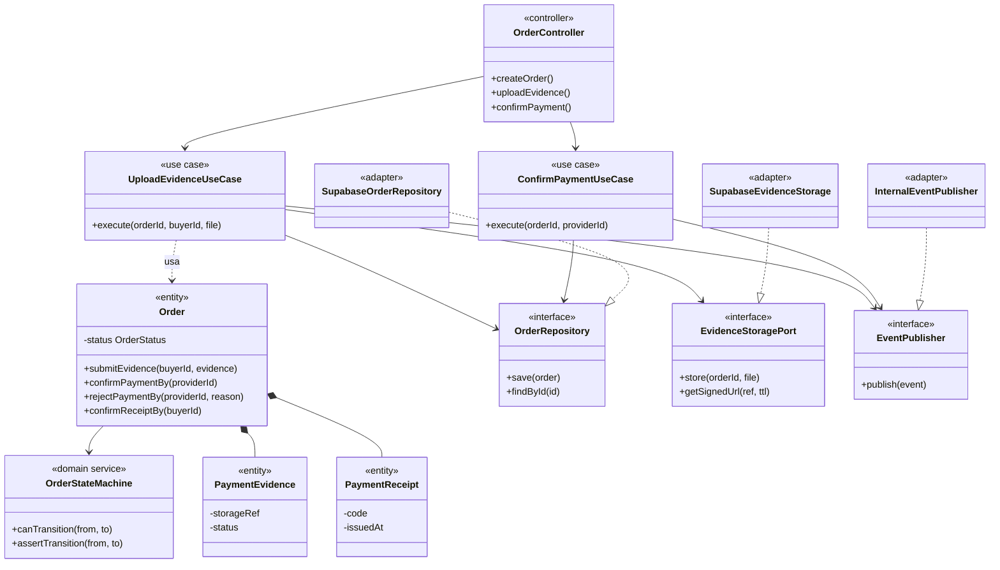
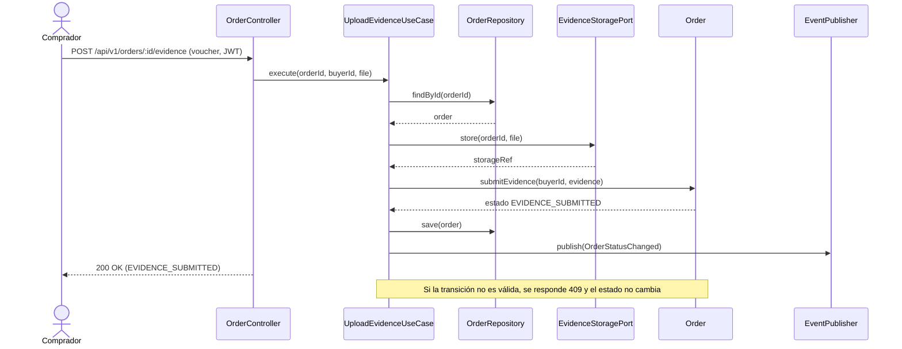

# Nivel 4 · Diagrama de código

> **Proyecto:** UniMarket · **Módulo detallado:** Orders  
> **Modelo:** C4 · Nivel 4 de 4 · **Notación:** UML · **Versión:** 1.0

---

## 1. Objetivo

Mostrar **cómo está organizado el código** de un componente del nivel 3: sus clases, interfaces y la forma en que colaboran. Se detalla el flujo **Subir voucher y confirmar el pago**, que involucra al módulo **Orders**, su almacenamiento privado y la publicación de eventos hacia Notifications.

| Aspecto | Descripción |
|---|---|
| Pregunta que responde | ¿Qué clases existen dentro de un módulo y cómo se relacionan? |
| Audiencia | Desarrolladores |
| Notación | UML (diagrama de clases y diagrama de secuencia) |
| Por qué solo Orders | El nivel 4 es opcional en C4 y se dibuja para el componente más complejo. Orders concentra la máquina de estados, el pago P2P, los vouchers y las disputas |
| Nivel anterior | `Nivel3-Diagrama-de-Componentes.md` |

---

## 2. Diagrama de clases

### 2.1 Capas de Clean Architecture

| Capa | Contiene | Regla |
|---|---|---|
| **Presentación** | Controladores, rutas, validadores | Traduce HTTP a llamadas del caso de uso y viceversa |
| **Aplicación** | Casos de uso, DTO, puertos | Coordina los pasos del proceso; no conoce la tecnología |
| **Dominio** | Entidades, objetos de valor, máquina de estados | Contiene las reglas del negocio; no importa Express, Supabase ni SDK externos |
| **Infraestructura** | Repositorios y adaptadores | Implementa los puertos con una tecnología concreta |

> **Regla de dependencia:** las flechas del código apuntan hacia el dominio. Las clases de infraestructura implementan interfaces (triángulo hueco); el dominio nunca conoce a la infraestructura.

### 2.2 Clases del módulo Orders

| Clase | Tipo | Capa | Responsabilidad |
|---|---|---|---|
| `OrderController` | Controlador | Presentación | Recibe las peticiones HTTP, extrae el usuario del JWT y mapea el resultado a códigos HTTP |
| `UploadEvidenceUseCase` | Caso de uso | Aplicación | Guarda el voucher, registra la evidencia en la orden y publica el cambio de estado |
| `ConfirmPaymentUseCase` | Caso de uso | Aplicación | El proveedor confirma el pago; se emite la constancia virtual |
| `Order` | Entidad | Dominio | Representa la orden, valida propiedad, rol y estado, y delega las transiciones en la máquina de estados |
| `PaymentEvidence` | Entidad | Dominio | Voucher del comprador: referencia de almacenamiento, tipo, tamaño y estado (sin datos bancarios sensibles) |
| `PaymentReceipt` | Entidad | Dominio | Constancia virtual inmutable emitida al confirmar el pago |
| `OrderStatus` | Objeto de valor | Dominio | CREATED, PENDING_PAYMENT, EVIDENCE_SUBMITTED, REJECTED, PAYMENT_CONFIRMED, COMPLETED, CANCELLED, EXPIRED, DISPUTED |
| `OrderStateMachine` | Servicio de dominio | Dominio | Define las transiciones permitidas; una transición inválida lanza `InvalidTransitionError` y no cambia el estado |
| `OrderRepository` | Interfaz | Aplicación | Contrato para guardar y buscar órdenes |
| `EvidenceStoragePort` | Interfaz | Aplicación | Contrato para guardar el voucher y obtener una URL firmada de corta duración |
| `EventPublisher` | Interfaz | Aplicación | Contrato para publicar eventos como `OrderStatusChanged` |
| `SupabaseOrderRepository` | Repositorio | Infraestructura | Implementa `OrderRepository` con PostgreSQL |
| `SupabaseEvidenceStorage` | Adaptador | Infraestructura | Implementa `EvidenceStoragePort` con el bucket privado de Supabase |
| `InternalEventPublisher` | Adaptador | Infraestructura | Publica el evento después de confirmar la transacción |
| `YapeInstructionStrategy`, `PlinInstructionStrategy`, `TransferInstructionStrategy` | Estrategias | Infraestructura | Muestran los datos y el QR de cada medio P2P; no verifican que el dinero llegó |

### 2.3 Transiciones permitidas

| Estado actual | Transiciones permitidas | Quién la dispara |
|---|---|---|
| CREATED | PENDING_PAYMENT | Sistema |
| PENDING_PAYMENT | EVIDENCE_SUBMITTED, CANCELLED | Comprador / plazo |
| EVIDENCE_SUBMITTED | PAYMENT_CONFIRMED, REJECTED, EXPIRED | Proveedor / plazo |
| REJECTED | EVIDENCE_SUBMITTED | Comprador (reenvío) |
| PAYMENT_CONFIRMED | COMPLETED, DISPUTED | Comprador / participante |
| EXPIRED | DISPUTED | Participante |
| DISPUTED | COMPLETED, CANCELLED | Administrador (2FA) |
| COMPLETED, CANCELLED | — (estados finales) | — |

---

## 3. Diagrama de secuencia: subir voucher

| Paso | Origen → destino | Acción |
|---|---|---|
| 1 | Comprador → `OrderController` | Envía `POST /api/v1/orders/:id/evidence` con el voucher (JPG o PNG) y el JWT |
| 2 | `OrderController` → `UploadEvidenceUseCase` | Valida formato y propiedad de la orden, y ejecuta el caso de uso |
| 3–4 | `UploadEvidenceUseCase` → `OrderRepository` | Busca la orden en PostgreSQL |
| 5–6 | `UploadEvidenceUseCase` → `EvidenceStoragePort` | Guarda el voucher en el bucket privado y recibe la referencia |
| 7–8 | `UploadEvidenceUseCase` → `Order` | Registra la evidencia; la máquina de estados pasa la orden a EVIDENCE_SUBMITTED |
| 9 | `UploadEvidenceUseCase` → `OrderRepository` | Guarda la orden |
| 10 | `UploadEvidenceUseCase` → `EventPublisher` | Publica `OrderStatusChanged`; Notifications avisa al proveedor |
| 11 | `OrderController` → Comprador | Responde `200 OK` con el estado de la orden |
| Alternativa | `Order` → `UploadEvidenceUseCase` | Si la orden no está en PENDING_PAYMENT o REJECTED, se lanza `InvalidTransitionError` y se responde `409 Conflict` |

Después, el proveedor revisa el voucher y llama a `POST /api/v1/orders/:id/confirm-payment`: `ConfirmPaymentUseCase` pasa la orden a PAYMENT_CONFIRMED y se emite la constancia virtual.

---

## 4. Patrones y principios que se ven en este nivel

| Elemento del diagrama | Patrón o principio |
|---|---|
| `SupabaseEvidenceStorage`, `InternalEventPublisher` | Patrón **Adapter** |
| `OrderRepository` y `SupabaseOrderRepository` | Patrón **Repository** |
| `Yape/Plin/TransferInstructionStrategy` | Patrón **Strategy** |
| `InternalEventPublisher` hacia Notifications | Patrón **Observer** (eventos internos) |
| Los casos de uso reciben interfaces, no clases concretas | Principio de **inversión de dependencias** (SOLID) |
| Una clase por responsabilidad (controlador, caso de uso, entidad, repositorio) | Principio de **responsabilidad única** (SOLID) |
| Orders usa a Catalog y Administration solo por interfaces públicas | Regla del **monolito modular** |

> Detalle completo en `03-diseño-de-software/diseño-interno/patrones-de-diseño.md` y `principios-de-diseño.md`.

---